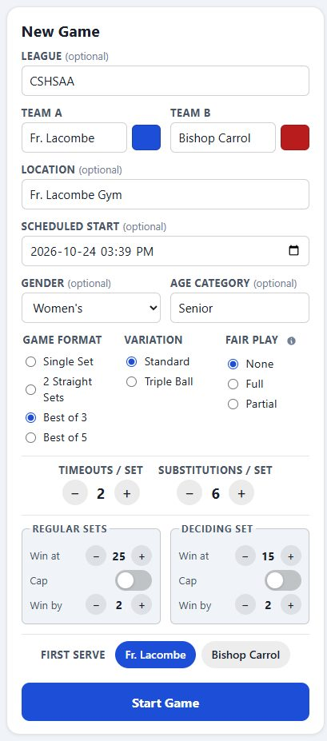
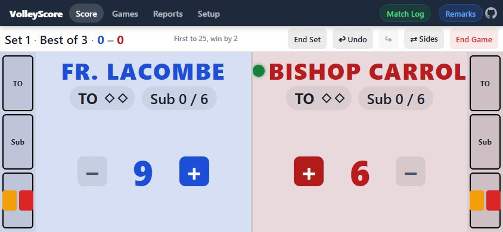
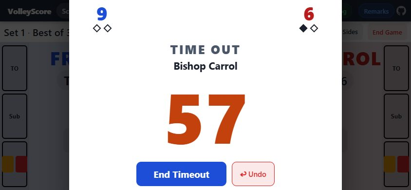
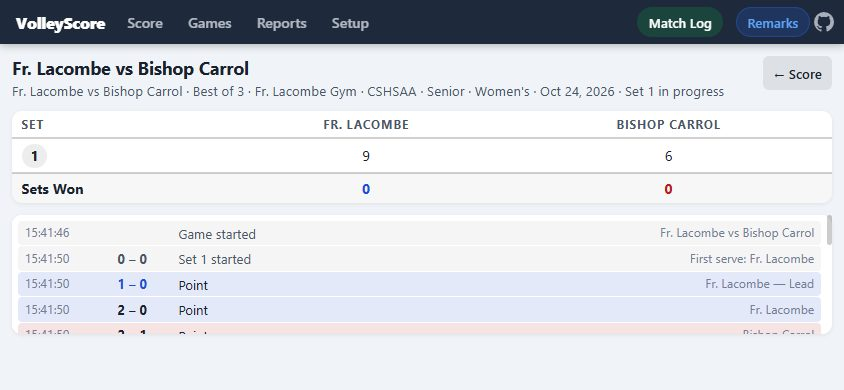
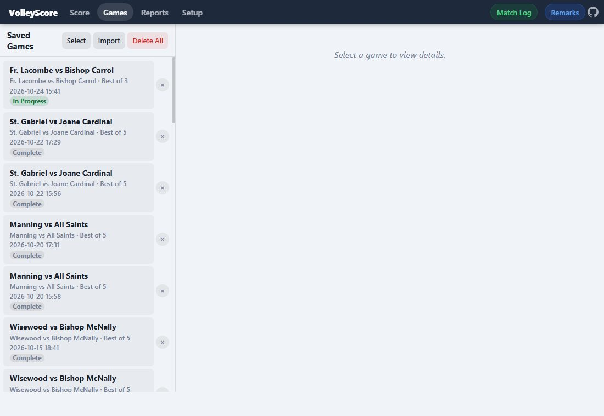
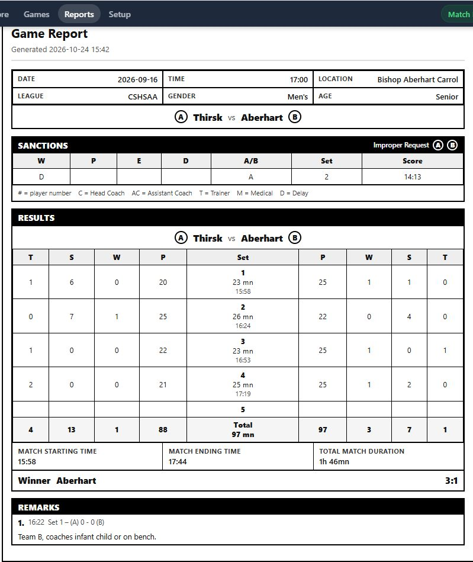

# VolleyScore

**Version 39**

Browser-based volleyball scorekeeper. No install, no build step — open `index.html` in any modern browser or use the hosted version:

**[https://j-mathes.github.io/VolleyScore/](https://j-mathes.github.io/VolleyScore/)**

**Jump to:** [Quickstart](#quickstart) · [Features](#features) · [Install as an app](#installing-as-a-pwa) · [Reference](#reference) · [Setup options](#setup)

---

## Installing as a PWA

<details>
<summary>Show install steps (iPhone, Android, desktop)</summary>

VolleyScore is a Progressive Web App. Install it for a full-screen, offline-capable experience. There is nothing to download from an app store — you install it straight from the website.

**Step 1 — Open the app in your browser first.** On the device you want to install it on, open the browser listed in the table below and go to:

**[https://j-mathes.github.io/VolleyScore/](https://j-mathes.github.io/VolleyScore/)**

Wait for the page to finish loading. The install options only appear once you are viewing the app itself, not this README or a link preview inside another app (e.g. Messages, email, or social media — if you tapped a link there, open it in Safari/Chrome instead).

**Step 2 — Install it** using the steps for your device:

| Platform | Steps |
|----------|-------|
| **iPhone / iPad — Safari** | Tap the **Share** button ⎙ (the square with an arrow pointing up — at the bottom of the screen on iPhone, top on iPad). Scroll down the menu and tap **Add to Home Screen** (if you don't see it, scroll further or tap **Edit Actions** and add it). On iOS 17.4+, leave **Open as Web App** switched on. Tap **Add** in the top-right corner. |
| **iPhone / iPad — Chrome / Edge (iOS 17+)** | Tap the **Share** button ⎙ in the address bar (top right on iPhone, or the ⋯ menu → Share). Tap **Add to Home Screen**, then tap **Add**. |
| **Android — Chrome** | Tap the **⋮** menu (top right). Tap **Install app** or **Add to Home Screen**, then tap **Install** / **Add** and confirm. You may also see an install banner at the bottom of the screen — tapping it does the same thing. |
| **Desktop — Chrome / Edge** | Click the install icon ⊕ at the right end of the address bar (or the ⋮ / ⋯ menu → **Install VolleyScore** / **Apps → Install this site as an app**), then click **Install**. |

**Step 3 — Launch it from your home screen (or Start menu / Applications folder on desktop)** using the new VolleyScore icon, just like any other app. It opens full-screen without browser chrome and works offline.

> **iPhone/iPad note:** Installing only works from a browser — Safari is the most reliable choice. Once installed, you can close the browser tab; the home-screen icon is all you need.

</details>

---

## Quickstart

A whole match, start to finish. Each step links to the section with the full details. (Screenshots use sample match data; the live-game shots are taken with the phone in landscape, which is the best way to use the Score page.)

### 1. Set up the game



On the **Score** page, fill in the **New Game** form:

- **League** first, if you use them — it narrows the team, age category, and location suggestions (see [League Associations](#league-associations)).
- **Team A / Team B** names (each has a color swatch for this match only — see [New Game Team Colors](#new-game-team-colors)), plus location, scheduled start, gender, and age category (see [Match Info Lists](#match-info-lists)). Tick the **Loc** box beside a team name to use that team's name as the location (see [Match Info Lists](#match-info-lists)).
- **Game format**, **variation**, and **fair play** rule (see [Game Formats](#game-formats), [Triple Ball](#triple-ball), [Fair Play Rules](#fair-play-rules)), then timeouts, subs, and the win-at / win-by / cap [scoring rules](#scoring-rules).
- **First Serve**, then **Start Game**.

Tired of retyping? Set your usual values once under **Setup → Game Defaults**, or turn on [Persist New Game Data](#persisting-new-game-data) to carry over the last match.

### 2. Start the first set

Confirm (or change) who serves, then tap **Start Set 1**. Picked the wrong server? A "Set N serve" chip stays in the game bar until the first point is scored — tap it to fix (see [Match Timing](#match-timing)). **⇄ Sides** swaps which side each team is shown on, or you can have it [switch automatically](#side-switching).

### 3. Score the match



- Tap **+** to score a point; the serve indicator follows along. **−** removes one.
- The sidebars hold **TO** (timeout), **Sub** (substitution), and the card icon for [sanctions](#sanctions). Dots and counters track what each team has left, and fair play rules enforce the limits for you.
- Playing Triple Ball? The [sequence indicator](#triple-ball) keeps the 3-ball rotation straight.
- When a team reaches the set-win condition the **End Set** button glows and a toast appears — the app never ends a set for you (see [Alerts](#alerts)). Made a mistake? **↩ Undo** and **↪ Redo** step through every action. Need to check the 8-second serve limit? The orange **8 🕗** button in the nav bar starts a quick count-up (see [Serve Timer](#serve-timer)).

### 4. Handle timeouts



Tapping **TO** can open a large countdown with both teams' score and timeouts used. **End Timeout** closes it early and **Undo** takes the timeout back if it was an accident. Optionally let it count up past zero (with a Pause button) to see how late a team is returning — see [Timeout Timer](#timeout-timer).

### 5. End the set, then the match

**End Set** → pick who serves → **Start Set 2** (it pulses green when ready), and so on. The deciding set gets a fresh coin-toss prompt for serve and side, and can prompt you to switch sides at 8 points (see [Side Switching](#side-switching)). When the match is decided, **End Game** glows → **Done** returns you to the New Game form.

### 6. Review the Match Log and add remarks



**Match Log** (nav bar) shows the set summary and every event in order — tap a set number to filter by set. **Remarks** (next to it) is a timestamped notepad for anything else that happened, with quick-pick text you define in Setup (see [Remarks](#remarks)).

### 7. Find, fix, and share games later



Every game saves automatically. On the **Games** page you can resume a game in progress, open any game's details, **Edit Info** to fix a team name or location afterward, and **Select** several to export or delete (see [Data & Storage](#data--storage) and [Editing a Game's Match Info](#editing-a-games-match-info)). Export on one device and import on another to move your history.

### 8. Print or export reports



On the **Reports** page, tick one or more games and build a **Match Log** summary table or a full FIVB-style **Game Report** score sheet — one page per game, with sanctions, results, and remarks. **Preview** it on screen, **Export Excel**, or **Print / PDF** (see [Reports](#reports)).

### 9. Make it yours

The **Setup** tab holds appearance and dark mode, game and scoring defaults, alert colors, your Match Info Lists, pre-defined remarks, and data tools (see [Setup](#setup)).

---

## Pages

| Page | Purpose |
|------|---------|
| Score | Live scorekeeping |
| Match Log | Event log + set summary (active games only) |
| Games | Browse, resume, export (one, several, or all at once), edit match info, or delete saved games (date and time shown for each) |
| Reports | Build printable/exportable reports across multiple saved games at once (see [Reports](#reports)) |
| Setup | Appearance, game defaults, scoring defaults, Match Info Lists, data management |

---

## Features

### Scoring & Live Play

- **Configurable scoring** — tap +/&minus; per team, with a per-game win target, win-by margin, and score cap for regular and deciding sets across four [game formats](#game-formats) (see [Scoring Rules](#scoring-rules))
- **Fair Play rules** — None / Triple Ball / Full / Partial, with timeout and sub limits enforced automatically (see [Fair Play Rules](#fair-play-rules))
- **Timeouts, substitutions & sanctions** — dot/diamond indicators track usage automatically; full misconduct and delay sanction system with escalation enforcement (see [Sanctions](#sanctions))
- **Timeout Timer** — optional large countdown popup when a timeout is called, with an Undo option in case it was called by accident (see [Timeout Timer](#timeout-timer))
- **Serve Timer** — an orange "8 🕗" button in the nav bar that counts up the 8-second serve limit as a quick reference, green until 8 and a pulsing red after (see [Serve Timer](#serve-timer))
- **Triple Ball** — animated 6-phase sequence indicator with directional arrows (see [Triple Ball](#triple-ball))
- **Undo / Redo, side switching & alerts** — full action history, flexible side-swapping (manual, automatic, or prompted), and configurable win/action glows and toasts; tapping Undo right after an accidental **Start Game** (before any set has started) becomes **Undo Start**, deleting that game in one tap instead of undoing through it (see [Side Switching](#side-switching), [Alerts](#alerts))
- **Remarks** — a free-form, timestamped notepad per match, with pre-defined quick-pick text, live during the game or edited after (see [Remarks](#remarks))

### Match Setup & History

- **Match Info tracking** — Gender, Age Category, and League per game, with editable master lists and many-to-many League associations that filter fields against each other (see [Match Info Lists](#match-info-lists))
- **Edit info after the fact** — correct team names, location, team colors, start time, remarks, or sanctions on any saved game, in progress or finished (see [Editing a Game's Match Info](#editing-a-games-match-info))
- **Scheduled vs. actual start time** — pre-configure a planned start time while the real moment **Start Game** is tapped is always recorded separately (see [Match Timing](#match-timing))
- **Persist New Game Data** — optionally carry every New Game field forward from your last match instead of resetting to defaults (see [Persisting New Game Data](#persisting-new-game-data))

### Data, Reports & Sharing

- **Save, export & import** — every game saves automatically as you play; export or import one game, a chosen subset, or your entire saved history (see [Selecting Games to Export or Delete](#selecting-games-to-export-or-delete))
- **Reports** — build a printable/exportable Match Log (multi-game summary table) or an FIVB-style Game Report score sheet, with in-app preview, Excel export, and print/PDF output (see [Reports](#reports))

### Appearance & Accessibility

- **Dark mode & custom colors** — team colors, sidebar border, Start Set button, and alert colors all customizable, with automatic low-contrast outlining so score text stays legible (see [New Game Team Colors](#new-game-team-colors))
- **Score button layout & size** — reorder the +/&minus; buttons or scale them larger to suit your device and preference
- **Keep Screen Awake** — optional Wake Lock so the screen doesn't sleep mid-match (iOS 16.4+ PWA, Android, desktop Chrome)
- **PWA / offline** — installs to your home screen, works without an internet connection, and shows an update toast automatically when a new version is cached

---

## Reference

Detailed documentation for every feature. The [Quickstart](#quickstart) above links into these sections.

---

## Game Formats

| Format | Sets | Match win |
|--------|------|-----------|
| Single Set | 1 | Win the set |
| 2 Straight Sets | 2 | Win both sets |
| Best of 3 | up to 3 | First to win 2 sets |
| Best of 5 | up to 5 | First to win 3 sets |

In Best of 3 and Best of 5, the last possible set uses **deciding set** scoring rules; all earlier sets use **regular set** rules. Both are independently configurable.

---

## Scoring Rules

Each game stores its own win conditions, set at game start. Global defaults live in **Setup → Scoring Defaults**.

| Setting | Description | Default |
|---------|-------------|---------|
| Win at | Score a team must reach to be eligible to win | 25 (regular) / 15 (deciding) |
| Win by | Minimum lead required once Win at is reached | 2 |
| Cap | Toggle — reaching this score wins immediately regardless of lead; must be ≥ Win at | off |

**Win by is automatically hidden** when Cap is enabled and `Cap − Win at ≤ Win by`, because the cap fires before a win-by lead becomes reachable. Example: Win at 15, Win by 2, Cap 16 — the cap at 16 means a 2-point lead from 15 (needing 16–14) is cut short, so Win by is hidden.

**Examples**

| Scenario | Regular sets | Deciding set |
|----------|-------------|--------------|
| Standard volleyball | Win at 25, Win by 2 | Win at 15, Win by 2 |
| Capped (wide margin) | Win at 25, Win by 2, Cap 28 | — |
| 2 Straight Sets to 15, capped at 17 | Win at 15, Cap 17 *(Win by hidden)* | n/a |
| Best of 3, short decider | Win at 25, Win by 2 | Win at 5, Cap 7 *(Win by hidden)* |

---

## Fair Play Rules

| Rule | Sets 1–2 | Deciding set |
|------|----------|--------------|
| None | Standard | Standard |
| Triple Ball | 3 TOs, no subs | 2 TOs, 12 subs (after last toss only) |
| Full | 3 TOs, no subs | 2 TOs, 12 subs (any time) |
| Partial | 2 TOs, subs unlock at 15 pts | 2 TOs, subs any time |

When a fair play rule is active the Timeouts/Set and Subs/Set steppers are hidden — the rule controls those values. For Partial, a toast fires when either team reaches 15 points.

---

## New Game Team Colors

Each team name field on the **New Game** form has a color swatch, pre-filled with the global default colors (Setup → Appearance → Team A/B Color — blue and red out of the box). Tap a swatch to open a preset color grid, or choose "Custom…" for the full color picker. This only affects that one game; leave it untouched to use the current defaults.

The override applies everywhere team color drives the UI — score panels, serve dot, sanctions bar, event log, Match Log tables, and so on. It doesn't change your saved global defaults, and returning to the New Game form always resets the swatches back to those defaults **unless a color has been remembered for that team name** (see below), in which case that remembered color wins over the global default.

### Remembered Team Colors

The app remembers the last color used for each team name. Type or pick a team that's used a color before (on the New Game form, in **Setup → Match Info Lists**, or when adding a new team name there) and its swatch auto-fills with that color; changing the color anywhere updates what's remembered for next time. In **Setup → Match Info Lists**, each Team Names chip shows a small color dot — tap the pencil (rename) icon to enter edit mode, where the dot becomes a clickable swatch you can change directly, without starting a game.

### Low-Contrast Color Outline

If a chosen team color is too close to the current background to read comfortably — e.g. a near-white pick in light mode, or a near-black pick in dark mode — the app automatically adds a thin outline (black in light mode, white in dark mode) to that team's score, name, and score buttons so they stay legible. This is fully automatic (based on an actual contrast check against the current theme, not just the color itself), re-evaluates whenever you switch dark mode on/off, and only kicks in for colors that are genuinely hard to see — well-contrasted colors are never outlined.

---

## Match Info Lists

The New Game screen tracks four extra pieces of match info, each backed by a master list you can pick from or type a new value into:

| Field | Type | Starts with |
|-------|------|-------------|
| Team Names | Grows from usage | Empty |
| Locations | Grows from usage | Empty |
| Gender | Fixed choice (Women's / Men's / not specified) | n/a — no list |
| Age Category | Editable list | Senior, Junior, 18U, 17U, 16U, 15U, 14U, 13U, 12U |
| League | Editable list | CSHSAA, ISAA, Foothills, Rockyview, Volleyball Alberta |

Team Name, Location, Age Category, and League fields are pick-or-type: tap the field to see a dropdown of existing values, keep typing to filter it, or type something new. Anything new you type is saved to that field's master list automatically **once you actually start the game** (or save an Edit Info change, or add it directly in Setup) — typing into the New Game form alone doesn't add anything to Setup → Match Info Lists until then, so an abandoned/unstarted game leaves no trace there.

**Using a team name as the location:** many matches are played at one of the two schools, so each team name has a **Loc** checkbox (to the left of its color swatch). Check one and the Location field fills with that team's name, greys out, and follows the name as you type or change it. Checking the other team's box moves the selection; unchecking leaves both clear (the default) and unlocks the field. The choice is remembered for the next match when **Persist New Game Data** is on.

### League Associations

Leagues can be linked to specific Team Names, Age Categories, and Locations (many-to-many — a team, age category, or location can belong to multiple leagues). Once a League is picked on the New Game form (or Edit Info), the Team A/B, Age Category, and Location fields only suggest entries already linked to that league — but you can still freely type a brand-new value regardless. Picking a Team A/B, Age Category, or Location *first* narrows the League suggestions the same way, in reverse.

Typing a brand-new value while a League is set links it to that league automatically. Reusing an existing value:

- **Not linked to any league yet** — links it silently, no prompt.
- **Already linked to a *different* league** — asks for confirmation before also linking it to the current one.

Manage links directly in **Setup → Match Info Lists → Leagues** — tap the people icon on any league to open a checklist of every team, age category, and location, and check/uncheck to link or unlink. There's also an **Infer League Associations from Saved Games** button that scans your saved match history and links whatever combinations of team/age category/location/league actually appeared together in a past game — handy for backfilling links for games recorded before this feature existed, without having to redo it all by hand.

### Managing the Lists

**Setup → Match Info Lists** shows every value in each list with a rename (&#9998;) button and a remove (&times;) button, plus an input to add a new value directly (without creating a game). Rename edits the chip in place (Enter or tap away to save, Esc to cancel) and re-sorts the list; it's also how you'd clean up a typo added by mistake without losing games that already reference the old value. The rename button can be hidden via **Setup → Match Info Lists → Show Edit (Pencil) Icons** if you don't want it cluttering the chip list.

Each list also has a filter box (type to narrow down a long list instead of scrolling) and a **Remove Unused** button that deletes any entries not referenced by a saved game — safe to run any time, since games store their own copy of these fields directly and don't depend on the master list.

**Setup → Game Defaults** lets you set a default Gender, Age Category, and League (in addition to the existing default team names and location) that pre-fill the New Game form. Each can still be overridden per game.

### Editing a Game's Match Info

Already started or finished a game with something wrong or missing? **Games → select the game → Edit Info** opens a form pre-filled with that game's current values. Nothing is saved until you press **Save**; **Cancel** throws all changes away.

- **Match info:** team names, location, gender, age category, and league. New values you type are added to the relevant master list, same as the New Game form.
- **Team colors:** change either team's color (also remembered for that team name).
- **Actual start time:** correct when **Start Game** was really tapped. It can't be set later than the first recorded event.
- **Remarks:** edit or delete any remark, or add a new one. A new remark on a finished game is labeled Post-Match; on a game still in progress it records the current set and score.
- **Sanctions:** each sanction is listed with its team, type, recipient, set, and score. Use ✎ to edit one or × to remove it, or **Add Sanction** to open a short form (team, type, recipient, set, and the score when it happened, starting at 0–0). A sanction is placed in the log right after the point that made that score. The usual rules still apply (one warning per team, escalation per person, one improper request).

Sanction changes only change the sanction record. They never change the score, so if a penalty point was wrong, the score has to be corrected separately. Saving updates the saved game (and the live scoreboard/Match Log too, if it's the game currently in progress); sets and points are otherwise untouched.

### Export / Import

**Setup → Data** can export and import the four lists — plus each Team Name's remembered color and every League association — as either:

- **JSON** — the app's own round-trip format.
- **Excel (.xlsx)** — one tab per category (Team Names, Locations, Age Categories, Leagues); Team Names also gets a Color column, and Team Names/Age Categories/Locations each get a Leagues column (comma-separated). You can edit values in Excel/Sheets/LibreOffice and import the file back in; sheets are matched by tab name, not position, so they can be in any order.

Either format merges into your existing lists rather than replacing them — nothing is deleted or overwritten wholesale, and a bad or hand-edited entry is skipped rather than breaking the rest of the import. (Exact merge rules in [Technical Notes](#technical-notes).)

---

## Persisting New Game Data

By default, the New Game form always resets to your configured defaults (Setup → Game Defaults) for a fresh match. Turning on **Setup → Game Defaults → Persist New Game Data Between Matches** changes this: instead of the defaults, the form pre-fills everything from the *last game you actually started* — team names, team colors, location, gender, age category, league, format, variation, fair play rule, timeouts/subs, scoring rules, and first server.

It's all-or-nothing — there's no way to persist only some fields. Scheduled Start is the one exception and always resets to the current time regardless of this setting, since carrying forward a stale timestamp wouldn't make sense. Turning the toggle off reverts to the original default-based behavior immediately.

---

## Alerts

The app never automatically ends a set or match — it only draws attention to win conditions.

### Win Alerts

When a team's score meets the set-win condition:

- **End Set** button glows persistently until the set is ended
- Winning team **name** and **score** flash a one-shot glow (fades out)
- Toast: `🏅 Team A at set win! (25–22 in Set 1)`
- If it also clinches the match: `🏆 Team A wins the MATCH! (25–22 in Set 2 · Sets 2–0)`
- After **End Set** reveals a match winner: `🏆 Team A wins the match! (2–0 sets)`
- **End Game** button glows between sets when a match winner is determined

Glows and toasts reset on Undo and re-fire if the winning point is re-scored.

Configure the glow color, glow duration, and win-condition toast duration independently in **Setup → Scoring Defaults → Win Alert**. Both durations default to 3 s and can be set from 1 to 30 seconds.

### Action Alerts

A one-shot glow (no toast) flashes on the relevant indicator for each action:

| Action | Glows on |
|--------|----------|
| Timeout taken | TO indicator (label + dots + count) |
| Substitution recorded | Sub counter |
| Sanction / delay sanction issued | The new chip in the sanctions bar |
| Improper request recorded | The IR chip |

Only the chip just added glows — existing chips are not re-glowed. Rapid repeat actions restart the animation.

Configure color and duration in **Setup → Scoring Defaults → Action Alert** (default: purple, 2 s).

### Score Change Glow

Pressing **+** or **−** gives a quick 0.8 s glow on that team's score number and on the button you pressed, so it's easy to confirm the right team scored. The color is picked automatically for each team: it contrasts with the team's color and with the current background, and is re-chosen when you switch between light and dark mode. The **+** symbol also switches between white and dark automatically so it stays readable on any team color (for example a white team in dark mode). There is no setting for this glow.

---

## Timeout Timer

An optional large on-screen countdown for timeouts — on by default.

- Toggle it in **Setup → Game Defaults → Timeout Timer** and set the duration in seconds (default 60, adjustable from 10 to 300 in steps of 5).
- When on, calling a timeout for either team shows a full-screen popup with the team name and a large, bold, high-contrast countdown (the color is tuned separately for light and dark mode so it stands out either way).
- Each team's current score and timeout diamonds (same outlined/filled style as the score screen) are shown at the top, on the side matching that team's current court side. The score is colored to match that team's color, same as the main scoreboard.
- **End Timeout** lets the referee dismiss it early if the timeout ends before time is up.
- **Undo Timeout** undoes the timeout entirely (in case it was called by accident) and closes the popup — equivalent to tapping the regular **Undo** button.
- If the countdown reaches 0, the popup stays up briefly (using the **Win condition toast duration** from Setup → Scoring Defaults → Win Alert) and then disappears automatically.
- **Count up after timeout ends** (Setup → Game Defaults → Timeout Timer, off by default, only available while the Timeout Timer is on): instead of auto-closing at 0, the timer keeps counting up with a minus sign (−1, −2, …) in red, pulsing with a glow on every tick (0.75 s), so you can see how long a team is taking to return to the court. It only closes when you tap **End Timeout** (or **Undo**).
- While counting up, a **Pause** button appears between **End Timeout** and **Undo**. Tap it to freeze the count (the button changes to **Resume** and glows while paused); tap again to continue. **End Timeout** and **Undo** still work while paused. There's no pause button during the normal countdown.

---

## Serve Timer

A quick on-screen reference for the 8-second serve limit. It is never recorded in the match data.

- The orange **8 🕗** button sits to the left of **Match Log** in the nav bar. It is only enabled while a set is in progress.
- Tap it to open a large count-up that starts at **1** (the way a referee counts in their head) and adds a second every second. The number is **green** through 8.
- From 9 on it turns **red** and pulses on every tick, with no minus sign.
- **Pause** freezes the count (the button changes to **Resume** and glows); tap again to continue. **End Count** closes it.
- If it reaches 20 it dismisses itself, in case the referee is busy with the game and not the app. A paused timer does not auto-dismiss.

---

## Sanctions

### Misconduct (individual)

| Sanction | Display | Effect |
|----------|---------|--------|
| Warning | 🟨 | No point; one per team per match |
| Penalty | 🟥 | Point + serve to opponent |
| Expulsion | 🟨🟥 | Player removed for rest of set |
| Disqualification | 🟨 🟥 | Player removed for rest of match |

Escalation is enforced — each sanction for the same individual must be higher than the last. Two roles are exempt from individual tracking:

- **Unnumbered players** — without a jersey number the app can't identify the individual, so escalation is not tracked and all levels remain available.
- **Asst. Coach** — each assistant may receive their own sanctions independently.

The team-level one-warning limit still applies to both.

### Delay (team)

| Sanction | Effect |
|----------|--------|
| Delay Warning 🟨⌚ | Caution only; one per team per match |
| Delay Penalty 🟥⌚ | Point + serve to opponent |

### Improper Request

One free per team per match. The button disables once used.

---

## Triple Ball

Three balls are played in sequence before the serve rotates. Six-phase cycle:

```
A Serves →   → B Toss   ← A Toss  |  B Serves ←   ← A Toss   → B Toss
   [0]          [1]        [2]     |     [3]           [4]         [5]
```

The first toss follows the serve direction; the second reverses it.

### Sequence Indicator

A scrolling column (landscape) or strip (portrait) between the team panels shows the previous, current, and next phase inside a stationary highlighted ring. Each box shows the team letter, action type, and a directional arrow that flips automatically on side-swap.

- The **serve dot** stays on the serving team for the full 3-ball half — scoring does not transfer it
- The **− button** acts as Undo, stepping the sequence back
- Configurable in **Setup → Triple Ball**: box size, highlight color, scroll speed

### Timeouts & Substitutions

Only allowed at phase 0 (before A serves) or phase 3 (before B serves). TO and Sub buttons disable at all other phases.

### Penalties

A Red card or Delay Penalty awards a point and advances the sequence. A toast identifies the replaced phase slot. A toggle in the sanction dialog handles mid-rally vs. after-rally.

---

## Match Timing

The **Scheduled Start** field (Score page setup, optional) lets you pre-configure a match for a planned time — useful when setting up a game ahead of the actual first serve. It has no effect on match logic.

Separately, the app always records the real-world moment **Start Game** is tapped as the match's actual start time. Wherever a single date/time is shown (Recent Games, Games list), the actual start time is used. In the **Game Detail** view and **Match Log** header, if the scheduled time and actual start differ, both are shown — e.g. `Scheduled Sep 9 19:00 · Started Sep 9 19:12`.

### Fixing the First Server

If the wrong team is picked to serve, a compact "Set N serve: Team X" chip stays available in the game bar for the *current* set — not just between sets — as long as its score is still 0–0. Tap the chip to open a popup and pick the other team; the chip disappears once either team scores a point, locking the server in. The correction is recorded in the Match Log.

### Side Switching

- Tap **⇄ Sides** anytime to swap which panel each team appears on; Triple Ball arrows and the sets-won indicator update immediately, including before the first set starts.
- **Setup → Game Defaults → Auto-switch sides between sets** does this automatically at the end of every set instead.
- **Setup → Game Defaults → Start match with sides swapped** (off by default) starts every new match with Team B on the left and Team A on the right.
- Deciding sets always get a fresh coin-toss prompt for serve and side, regardless of that setting — real matches call for a new toss there.
- **Setup → Game Defaults → Prompt to switch sides at 8 pts (deciding set)** (on by default) additionally asks to switch once the first team reaches 8 points in the deciding set; Triple Ball waits for the current 3-ball sequence to finish first, so it may fire at 8, 9, or 10 points. Leave it off to switch manually with **⇄ Sides** whenever you judge best.

---

## Remarks

A free-form, timestamped notepad for each match — for anything the structured event log doesn't capture (delays, weather, injuries, official rulings, and so on).

- While a game is live, a **Remarks** button appears in the top nav next to **Match Log**. Tap it to open a popup, type a note, and tap **Add Remark**.
- Common situations come up again and again, so you can pre-define remark text in **Setup → Pre-defined Remarks** and pick from that list instead of typing it out each time — tap **Choose from List** in the popup, pick one, and it fills the text box (still editable before you tap **Add Remark**, so you can tweak or add detail first). The order you arrange them in Setup (use the ▲▼ arrows) is the order they're listed in that picker. Ships with one default: "Game delayed due to previous match."
- **Placeholders** let a pre-defined remark auto-fill or prompt for details instead of you typing them out live — handy for things like "GAME CAPTAIN RE-DESIGNATED - TEAM {TEAM}, SET {SET}, SCORE ({SCORE}), {PLAYER} -> {PLAYER}". In Setup, tap the **Insert placeholder** buttons to add one at the cursor instead of typing the braces yourself:
  - `{SET}` and `{SCORE}` always auto-fill from the game in progress, no prompt.
  - `{TEAM}` prompts you to pick Team A or B when you use the remark — picking a team also puts **that team's score first** in `{SCORE}` (e.g. Team B leading 12-9 becomes "12 - 9" instead of "9 - 12").
  - `{PLAYER}` prompts for a jersey number only. `{STAFF}` prompts for a jersey number **or** a staff role (Head Coach, Asst. Coach, Trainer, Medical) — exactly like picking who a sanction applies to; use it only where a staff member could plausibly be involved. Use either more than once in the same remark (e.g. two `{PLAYER}` for an outgoing/incoming substitution) and each occurrence gets its own prompt.
  - Picking a preset with any `{TEAM}`/`{PLAYER}`/`{STAFF}` placeholders opens a small **Fill In Remark Details** popup first; the finished text then fills the box exactly like today, still editable before you tap **Add Remark**. A preset with only `{SET}`/`{SCORE}` (or no placeholders at all) fills in immediately with no extra popup.
- The pre-defined remarks list can be exported/imported separately as JSON, Excel, or CSV (Setup → Pre-defined Remarks) — importing merges in any new entries (duplicates skipped) without touching your existing list or its order.
- You never number remarks yourself — each one is numbered automatically (1, 2, 3, ...) in the order it was added.
- Every remark also records the time, set, and score at the moment it was added, e.g. `Set 2 – (A) 15 - 12 (B)`. Before the first set starts, or between sets, the score is always 0-0 and the set number reflects how many sets have been completed so far (`Set 0` before Set 1 has started, `Set 1` between Sets 1 and 2, and so on).
- Remarks also appear inline in the **Match Log** event log, in time order alongside every other event — its score column shows the score at that moment, since its position in the log already tells you which set it happened in.
- On the **Games** page, the **Game Detail** view has a collapsible **Remarks** section — positioned just above **Event Log** — listing every remark for that game, or "No remarks recorded." if there aren't any. Tap the pencil ✎ icon to enter edit mode, which reveals **Save** and **Delete** (with a confirmation prompt) for every remark. Once a game is complete, edit mode also reveals an **Add a post-match remark** box for jotting down a note after the fact — its timestamp shows both the date and time (since it isn't necessarily added same-day), and it's labeled **Post-Match** instead of a set/score, since none applies. Games saved before this feature existed simply show no remarks.
- The **Game Report** (see [Reports](#reports)) includes a Remarks box below Results, listing every remark or "None" if there aren't any.
- Remarks are ordinary game data, so they're included automatically in every export/import path (single game, multi-select, or full export).

---

## Data & Storage

Games save automatically to `localStorage` with an IndexedDB fallback when storage is nearly full. Export and import via JSON — one game, a chosen subset, or the full collection. Transfer between devices by exporting on one and importing on the other.

### Selecting Games to Export or Delete

On the **Games** page, tap **Select** to enter selection mode: a checkbox appears next to each saved game, along with a select-all checkbox and a running count. Check as many games as you want (or **All**), then either **Export Selected** to download them as one JSON file (the same round-trip format used by the single-game and export-all options) or **Delete Selected** to remove just those games (confirmation required — export first if you want a backup). Tap **Done** to leave selection mode.

### Import & Match Info Lists

Importing any game file (single game, a multi-select export, or a full export) also scans each game's Team A/B names, Location, Age Category, and League and adds any values not already present to the corresponding master list — the same lists used by the New Game form's pick-or-type fields (see [Match Info Lists](#match-info-lists)). Existing entries are left untouched; the import summary reports how many new list entries were added alongside the game count.

---

## Reports

The **Reports** page builds printable/exportable reports across any subset of your saved games. Every report shares the same header (VolleyScore, the report title, and when it was generated) and a footer with the project's GitHub URL that repeats on every printed page. If you've set **Setup → Game Defaults → Referee Name**, the header also shows "Referee: [name]" — leave it blank if you're not a referee, since it's entirely optional and simply omitted when unset.

### Match Log

1. Check the games you want in the list at the top (or **Select All** / **Select None**) — the count updates live. The list is sorted by date/time (newest first by default); tap the **Date: Newest/Oldest first** button to flip the order.
2. The report table below builds automatically in the same order as the list above, with columns: Date (`YYYY-MM-DD`), Time (24-hour, prefers each game's scheduled start and falls back to its actual start), Location, Teams, League, Age, Gender, Set Score (e.g. `3-2`), and Set Points (e.g. `25-22, 14-25`). Any field a game doesn't have shows `N/A`.
3. **Preview** opens an in-app, on-screen approximation of the printed report — a simulated letter-size page so you can check it before committing to a file or a printer.
4. **Export Excel** downloads a single-sheet `.xlsx` with the same rows.
5. **Print / PDF** opens the browser's print dialog, formatted to fit a letter-size page and flow across multiple pages automatically if the row count doesn't fit on one.

### Game Report

A detailed, printable score sheet modeled on the official FIVB score sheet, adapted to the fields VolleyScore actually records. Unlike Match Log's single summary table, **each selected game gets its own full page** in the preview, Excel export, and print/PDF, in the same order as the game list above (same **Date: Newest/Oldest first** toggle as Match Log).

- **Match Info** — Date, Time, Location, League, Gender, Age, and both team names next to A/B circles.
- **Sanctions** — one row per sanction, in the order it happened: which of W (Warning) / P (Penalty) / E (Expulsion) / D (Disqualification) applies, who received it (`#12` for a player, or `C` / `AC` / `T` / `M` for Head Coach / Assistant Coach / Trainer / Medical — delay sanctions show `D`), the team and set, and the score at that moment (the sanctioned team's score listed first). A legend explains the abbreviations; the box just reads **None** if there weren't any. Two circle badges next to "Improper Request" mark whether either team has used their one free request, with a bold **X** once it has.
- **Results** — one row per set the format allows (even sets never played, shown blank), with each team's Timeouts, Subs, Won (1/0), and Points, plus the set number, its duration in minutes, and its start time. Sets are always treated as having exactly a 3-minute break between them, regardless of how long the real gap was, matching the official rule; the final set's duration is adjusted so the whole timeline lines up exactly with the game's real end time. A totals row, Match Starting/Ending Time, Total Match Duration, and the Winner (full team name + sets score) finish the box.
- **Remarks** — every remark recorded for the game (see [Remarks](#remarks)), numbered with its time and the set/score it was made at; reads **None** if none were recorded.
- **Preview**, **Export Excel** (one workbook sheet per game, with team names as merged headers over their columns), and **Print / PDF** work the same way as Match Log, just paginated one game per page.

---

## Setup

| Section | Settings |
|---------|----------|
| Appearance | Dark mode, font size, team colors, sidebar border, Start Set button colors, score button layout (&minus;/+ order and mirroring) and size (100%&ndash;300%, height-only growth past 200%), Keep Screen Awake, Confirm before Undo, notch padding (side and amount — useful in landscape when the phone notch covers the sidebar) |
| Game Defaults | Persist New Game Data toggle (see [Persisting New Game Data](#persisting-new-game-data)); Referee Name (optional — used on reports, see [Reports](#reports)); default team names, location, gender, age category, league, scheduled start (see [Match Timing](#match-timing)), format, variation, fair play rule, side switching (see [Side Switching](#side-switching)), timeouts/set, subs/set, Timeout Timer (see [Timeout Timer](#timeout-timer)) |
| Scoring Defaults | Win at / Cap / Win by for regular and deciding sets; Win Alert glow and toast color/duration settings; Action Alert color and duration |
| Match Info Lists | Add/rename/remove Team Names, Locations, Age Categories, and Leagues; toggle to show/hide the rename (pencil) icons (see [Match Info Lists](#match-info-lists)) |
| Pre-defined Remarks | Add/edit/remove/reorder the quick-pick remark texts used by the live Remarks picker; export/import the list as JSON, Excel, or CSV (see [Remarks](#remarks)) |
| Data | Export/import all games (JSON, one/several/all — see [Selecting Games to Export or Delete](#selecting-games-to-export-or-delete)); export/import Match Info Lists (JSON or Excel) (see [Match Info Lists](#match-info-lists)); clear all data |
| Triple Ball | Phase box size, highlight color, scroll speed |
| About | App version and cache name; update toast appears automatically when a new version is cached |

---

## Technical Notes

Implementation details that aren't necessary for everyday use — useful if you're troubleshooting, hand-editing an exported file, or just curious how things work under the hood.

### Match Info Lists import merge rules

- New list values and new league links are added; duplicates (including ones that only differ by case) are skipped.
- A color for a team you already have gets updated to the imported value.
- A hand-edited file with an invalid entry (wrong type, or a league link referencing a team/league that isn't otherwise in the file) is skipped rather than breaking the whole import.

### Stack

Vanilla JavaScript — no frameworks, no build step. Files: `app.js`, `styles.css`, `index.html`, `manifest.json`, `sw.js` (service worker), `icons/`.

---

## License

Copyright © 2025 Jared Mathes — [CC BY-NC-SA 4.0](https://creativecommons.org/licenses/by-nc-sa/4.0/)
